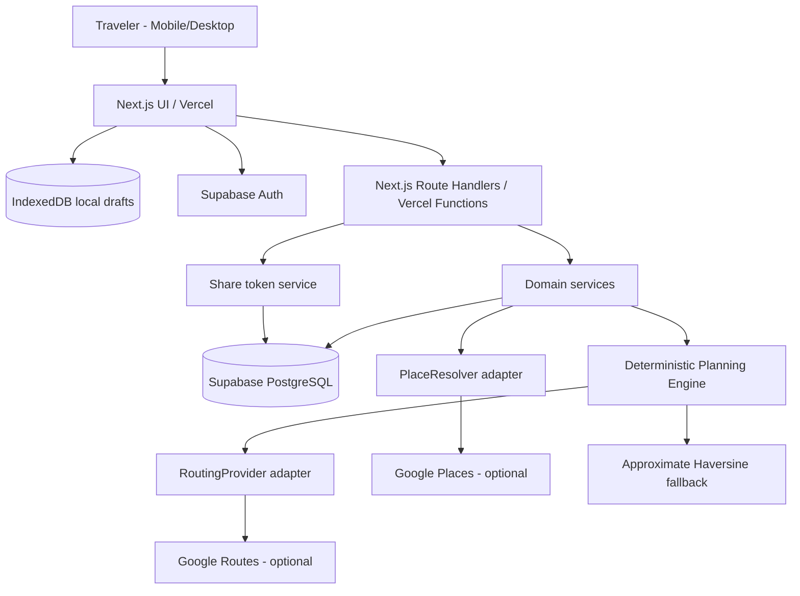

# VIETNAM PLAYFUL TRAVEL PLANNER — MASTER PLANNER

> Version: 1.0 • Ngày: 2026-10-21 • Trạng thái: BASELINE / CHƯA TRIỂN KHAI  
> Mục tiêu: Tài liệu nguồn duy nhất cho Product, Design, Engineering, QA và Coding Agent.  
> Ngôn ngữ giao diện MVP: tiếng Việt; kiến trúc sẵn sàng i18n.  
> Điểm đến thử nghiệm: Nha Trang. Mở rộng bằng dữ liệu tới Đà Lạt, Đà Nẵng, Hà Nội.
> Scope amendment 2026-10-21: user yêu cầu bổ sung catalog Đà Lạt ngay (ADR-0013); mỗi trip vẫn một thành phố. G0 baseline/ODbL đã được user duyệt; chưa cho phép bỏ qua gate triển khai.

## 0. Executive decisions — các quyết định mặc định

| ID | Quyết định | Lý do |
|---|---|---|
| ADR-01 | Next.js App Router + TypeScript, deploy Vercel | Full-stack không cần tự quản lý máy chủ |
| ADR-02 | PostgreSQL Supabase + Supabase Auth | Lưu dài hạn, RLS, xác thực guest-first |
| ADR-03 | IndexedDB (Dexie) cho local drafts | Tiếp tục làm việc khi offline, tránh mất bản nháp do refresh |
| ADR-04 | Catalog địa điểm tự biên tập, có nguồn ảnh hợp pháp | Kiểm soát chất lượng nội dung, giấy phép và phong cách |
| ADR-05 | Google Places/Routes là adapter tùy chọn, có kiểm soát chi phí | Không ràng buộc engine vào một nhà cung cấp |
| ADR-06 | Planner deterministic, rule-based trước AI | Kết quả kiểm thử được, có lý do loại điểm và xung đột |
| ADR-07 | Mã chia sẻ chỉ cho **xem**; chỉnh sửa cần quyền chủ sở hữu | Ngăn lạm dụng mã để sửa lịch trình |
| ADR-08 | Nha Trang + catalog Đà Lạt theo yêu cầu user (ADR-0013); chưa tối ưu liên thành phố | Mở rộng bằng dữ liệu độc lập, giữ gate và cách ly destination |
| ADR-09 | GSAP/Motion cho interaction; Three.js chỉ progressive enhancement | Hiệu năng trên thiết bị tầm trung |
| ADR-10 | Không lưu/caching dài hạn dữ liệu Google bị hạn chế; Place ID có ngoại lệ | Tuân thủ Terms của Google Maps Platform |

### Khả năng và giới hạn hạ tầng

- Không cần dedicated server: Vercel Functions đảm nhiệm API stateless; Supabase quản lý PostgreSQL/Auth/Storage.
- Các secret/API key chỉ được giữ ở server; không đưa service-role key ra client.
- Không triển khai worker chạy mãi trên Vercel. Yêu cầu có công việc > timeout phải chuyển thành job kiến trúc riêng ở bản nâng cấp; MVP giới hạn kích thước bài toán và thời gian xử lý.
- Google Maps API cần billing và quota/budget alerts. Không định nghĩa “miễn phí không giới hạn”.
- Vercel Hobby là gói cho mục đích cá nhân, phi thương mại; đánh giá nâng cấp trước khi thương mại hóa.

---

# PHẦN A — PRD

## 1. Product vision & problem statement

### 1.1 Tầm nhìn

Website chuyển các địa điểm người dùng quan tâm thành lịch trình du lịch khả thi theo ngày và giờ, được tối ưu dựa trên nơi lưu trú, thời gian, phương tiện, giờ hoạt động và sở thích. Phong cách sản phẩm: vui vẻ, chibi, 2.5D/illustration, chỉn chu, nhanh, dễ dùng trên mobile.

### 1.2 Vấn đề cần giải quyết

1. Người dùng lưu địa điểm rời rạc trên Google Maps nhưng khó chia lịch theo khu vực và giờ.
2. Lịch trình tham khảo thường bỏ qua thời gian đi lại, giờ hoạt động, giờ check-in/out và các ngày đi chưa trọn vẹn.
3. Chia sẻ kế hoạch qua chat hoặc file dễ mất phiên bản; khó khôi phục từ thiết bị khác.
4. Website gợi ý du lịch thường thiếu trải nghiệm mang tính địa phương và trực quan.

### 1.3 Persona

- P1 — Người đi du lịch tự túc: 2–5 ngày, dùng điện thoại, muốn lịch trình có thể triển khai ngay.
- P2 — Nhóm bạn/gia đình: gửi danh sách địa điểm và chia sẻ lịch cho người khác xem; cộng tác thời gian thực chưa thuộc MVP.
- P3 — Người chưa biết đi đâu: xem catalog minh họa và thêm địa điểm vào kế hoạch.

### 1.4 Jobs-to-be-done

- “Khi đã có danh sách Google Maps, tôi muốn paste từng link và được xếp thành hành trình khả thi.”
- “Khi chọn khách sạn, tôi muốn biết nhóm địa điểm nào thuận tiện đi lại hơn.”
- “Khi đi du lịch, tôi muốn mở lại kế hoạch bằng mã mà không phải tạo lại.”

## 2. Phạm vi MVP

### 2.1 Bắt buộc (P0)

| Mã | Yêu cầu chức năng | Mức |
|---|---|---|
| FR-001 | Trang chủ giới thiệu, cho chọn Nha Trang hoặc Đà Lạt (ADR-0013) | MUST |
| FR-002 | Catalog 30–50 địa điểm biên tập: phân loại, ảnh, mô tả, tọa độ, thời lượng gợi ý | MUST |
| FR-003 | Tạo trip với ngày đến/về, giờ đến/về, múi giờ, nhịp độ, phương tiện | MUST |
| FR-004 | Chọn khách sạn/nơi lưu trú bằng catalog hoặc nhập/tìm địa chỉ, tọa độ | MUST |
| FR-005 | Thêm/xóa/chọn ưu tiên điểm từ catalog | MUST |
| FR-006 | Nhập Google Maps URL; phân giải an toàn; xác nhận đúng địa điểm, chọn thủ công nếu không nhận dạng được | MUST |
| FR-007 | Planner tự chia điểm theo ngày, xếp trong giờ hoạt động, di chuyển có buffer | MUST |
| FR-008 | Hiển thị timeline theo ngày, giải thích điểm chưa xếp và lý do | MUST |
| FR-009 | Người dùng sửa lịch, kéo thả điểm và khóa điểm; engine kiểm tra lại xung đột | MUST |
| FR-010 | Tự lưu bản nháp vào IndexedDB, khôi phục sau reload | MUST |
| FR-011 | Lưu trip lên Supabase, phân quyền theo chủ sở hữu | MUST |
| FR-012 | Sinh mã chia sẻ ngẫu nhiên, nhập mã để xem lại, có thể thu hồi | MUST |
| FR-013 | Có nút mở Google Maps tới từng điểm và itinerary mobile responsive | MUST |
| FR-014 | Loading, empty, error, offline states; giao diện tiếng Việt | MUST |
| FR-015 | Dữ liệu demo / test hoạt động không phụ thuộc khóa Maps thật | MUST |

### 2.2 Nên có (P1, sau khi P0 pass)

- PWA và offline trip pack đã tải; PDF/export; ước tính chi phí cơ bản dựa dữ liệu tự nhập; export lịch; lịch sử phiên bản; thêm catalog nhiều tỉnh; cải thiện POI discovery; nâng cấp tài khoản anonymous -> Google/email.
- Preferences nâng cao: “tránh đi quá nhiều”, giờ ăn ưu tiên, hạn chế quãng đường. Chọn điểm bắt buộc/không bắt buộc và required-first là P0 theo FR-005 và engine (ADR-0011).

### 2.3 Chưa thực hiện ở MVP (P2)

- AI tự tạo bài giới thiệu và lịch trình không kiểm chứng; đặt vé/phòng; thanh toán; bình luận công khai; cập nhật giá tự động; multi-user realtime; đề xuất weather live; 3D nặng toàn trang; tự động scraping Google Maps; tối ưu đa thành phố và đa khách sạn phức tạp; ứng dụng iOS/Android native.

## 3. UX flow và điều kiện nghiệp vụ

### 3.1 Pages / sitemap

- `/` — Landing, city selector, hero minh họa.
- `/destinations/[slug]` — Catalog địa điểm, bộ lọc, search cho `nha-trang` và `da-lat` theo ADR-0013; slug khác không được giả làm thành phố đã hỗ trợ.
- `/plan/new` — Wizard 4 bước: dates -> lodging/transport -> places -> preferences.
- `/trips/[tripId]` — Owner editor, timeline, bản đồ, trạng thái save (yêu cầu session).
- `/open` — Nhập mã kế hoạch; trả về read-only shared view.
- `/shared` — Read-only viewer: client đọc fragment token rồi POST tới server resolve opaque token/hash, không giải mã trip ở client (ADR-0011).
- `/privacy`, `/terms` — Quy định dữ liệu và nhà cung cấp.
- `/admin` — Không có public route MVP; dữ liệu biên tập bằng seed/migration nội bộ.

### 3.2 UX hành trình chuẩn

1. Chọn Nha Trang; xem catalog; có thể thêm điểm trước khi tạo trip.
2. Nhập `start_date`, `end_date`, giờ đến và giờ rời vào hai ngày rìa; hệ thống **dẫn xuất** số ngày theo lịch địa phương, không cho nhập số ngày độc lập mâu thuẫn.
3. Nhập chỗ ở (nếu chưa biết thì cho chọn `base_location` tạm; lịch dựa trên tọa độ tạm phải hiển thị cảnh báo).
4. Chọn phương tiện, nhịp độ, điểm must-visit; nhấn Generate.
5. Xem timeline, điểm chưa xếp, travel times (ước tính hoặc lấy từ API có nhãn), chỉnh sửa.
6. Nhấn Save; hệ thống tạo/duy trì anonymous session, lưu trip. Người dùng chọn tạo mã xem-only, sao chép code/link.
7. Người nhập mã ở thiết bị khác chỉ **xem** kế hoạch; không thể sửa bản gốc nếu chưa xác thực là chủ sở hữu.

### 3.3 Business rules

- BR-01: `end_date >= start_date`, ngưỡng MVP 1–7 ngày; khoảng dài hơn báo cần rút ngắn.
- BR-02: tối đa 30 điểm người dùng chọn / trip, tối đa 8 điểm scheduled / ngày; configurable, không “nhét” cho đủ số điểm.
- BR-03: hỗ trợ ngày đầu/ cuối không trọn ngày; không xếp trước giờ đến/ sau giờ khởi hành; tính thêm buffer di chuyển vào/ra.
- BR-04: tất cả thời gian domain lưu theo IANA timezone tại điểm đến; timestamps thực thi lưu UTC; UI định dạng theo timezone trip.
- BR-05: lịch trình tôn trọng cửa sổ giờ mở cửa **được xác minh và có độ tin cậy**. Nếu thiếu giờ thì để trạng thái `hours_unknown`, không tuyên bố chắc chắn là mở.
- BR-06: giới hạn hoạt động ngoài trời / cường độ tùy pace; ăn trưa/ nghỉ là buffer mặc định có thể tắt.
- BR-07: nếu địa điểm trùng `catalog_place_id` hoặc `google_place_id`, không thêm trùng tự động; yêu cầu xác nhận nếu khác ID nhưng tọa độ và tên gần nhau.
- BR-08: khi kéo thả, giữ các “locked stop” và báo nếu vi phạm constraint thay vì âm thầm thay đổi.
- BR-09: Nha Trang và Đà Lạt theo ADR-0013; mỗi trip một destination, không trộn hai catalog; POI ngoài city envelope của destination cho phép nhưng gắn warning “xa trung tâm” và có thể đánh dấu không khả thi.
- BR-10: nếu route API lỗi/không có key, planner chạy approximate offline mode và đánh dấu `estimate_source=approximate` (không quảng cáo là ETA thực tế).
- BR-11: thao tác xem mã read-only không xác lập quyền sở hữu; xóa code không xóa chuyến đi.
- BR-12: không thu thập vị trí GPS hiện tại theo mặc định; chỉ xin quyền khi người dùng chọn một tính năng cần vị trí.

## 4. Acceptance criteria cấp sản phẩm (Gherkin rút gọn)

- AC-001 — Given một trip 3 ngày, When chỉnh ngày đến/về, Then tổng số ngày và từng ngày local đều cập nhật chính xác.
- AC-002 — Given chọn 10 POI, When Generate, Then tất cả được chia thành `scheduled` hoặc `unscheduled` có lý do; không có POI bị biến mất.
- AC-003 — Given POI có hours 09:00–17:00, When lập lịch, Then visit start >=09:00 và visit end <=17:00, trừ khi hours unknown đã có warning.
- AC-004 — Given ngày cuối checkout/khởi hành 14:00, When Generate, Then kết thúc lịch trước ngưỡng đủ để quay về và khởi hành.
- AC-005 — Given khách sạn đổi tọa độ, When Regenerate, Then travel matrix được tính lại và lịch thể hiện nguồn estimate.
- AC-006 — Given Google Maps short URL hợp lệ, When Import, Then UI hiển thị ứng viên để user xác nhận, hoặc nhập thủ công nếu không xác định được.
- AC-007 — Given URL không hợp lệ/redirect ra localhost/private network, When Import, Then API từ chối mà không fetch.
- AC-008 — Given hoàn thành chỉnh trip, When Reload, Then draft được IndexedDB khôi phục cùng version.
- AC-009 — Given share code hợp lệ, When thiết bị khác nhập mã, Then hiển thị bản xem đúng trip và không có nút chỉnh sửa.
- AC-010 — Given share code sai hoặc bị revoke, When resolve, Then API trả lỗi an toàn, không rò thông tin trip.
- AC-011 — Given user B biết UUID trip A, When gọi owner API, Then nhận 403/404, không được xem chi tiết.
- AC-012 — Given Maps API bị 429/5xx, When lập lịch, Then hệ thống fallback/cảnh báo thay vì mất dữ liệu.
- AC-013 — Given save cạnh tranh từ 2 tab, When gửi version cũ, Then server báo `VERSION_CONFLICT` và có chọn reload/giữ bản local.
- AC-014 — Given thiết bị màn hình 360px, When xem landing, wizard, timeline, Then không có horizontal overflow và mọi điều khiển sử dụng được.
- AC-015 — Given lựa chọn reduced motion, When chuyển trang, Then animation lớn được tắt/giảm.

## 5. Non-functional requirements (NFR) và SLO mục tiêu

Các ngưỡng sau là **đích thử nghiệm nội bộ, chưa phải cam kết production**:

| ID | Mục tiêu | Ngưỡng/Gate |
|---|---|---|
| NFR-01 | Mobile performance | Lighthouse mobile Performance >= 80 trên ít nhất 3 trang trọng yếu ở điều kiện test đã cố định |
| NFR-02 | Accessibility | WCAG 2.2 AA cho journey chính; keyboard navigation, focus, contrast, aria label |
| NFR-03 | Planner speed | <= 3 giây p95 với fixture <= 15 POI và matrix đã chuẩn bị trên môi trường test; API có network phải đo riêng |
| NFR-04 | API predictability | Errors theo một envelope; validation schema trên server |
| NFR-05 | Security | Không lộ secrets; RLS tests pass; share code >=128-bit entropy; rate limit được test |
| NFR-06 | Resilience | Reload không mất draft; fallback khi Maps API fail; action idempotent |
| NFR-07 | Observability | Error tracking, requestId, chi phí và latency theo adapter, không log mã share hoặc PII |
| NFR-08 | Privacy | Có chính sách dữ liệu, xóa trip, quyền kiểm soát chia sẻ và retention |
| NFR-09 | Cost control | Có per-request quota, per-user quota, daily budget alert, field masks tối thiểu |
| NFR-10 | Cross-browser | Chrome/Edge/Safari/Firefox bản hiện hành; iOS Safari và Android Chrome smoke tests |

---

# PHẦN B — KIẾN TRÚC HỆ THỐNG

## 6. Component architecture



### 6.1 Logical modules

- `catalog`: destination, place, search & filter, editorial metadata.
- `trip`: trip draft, stops, preference, optimistic versioning, history.
- `import`: parser Google Maps URLs, identity matching, validation.
- `routing`: adapter với `estimateMatrix(input): Promise<MatrixResult>`; mock + approximate + Google.
- `planning`: clustering, scheduling, scoring, repair, feasibility reports.
- `sharing`: tokens, hash, revoke, scope viewer; tuyệt đối không dùng share token để mutate owner data.
- `persistence`: Postgres repositories, client IndexedDB persistence.
- `telemetry`: event names định nghĩa sẵn và privacy-safe logging.

### 6.2 Tech stack chuẩn hóa

- Next.js (phiên bản ổn định được chọn lúc scaffold), React, strict TypeScript, `zod`, Tailwind CSS, shadcn/ui.
- TanStack Query cho server state; Zustand hoặc React Context nhẹ cho planner state (chọn một và ghi ADR lúc bootstrap).
- Supabase SDK (SSR/Auth), SQL migrations + RLS; Dexie.js cho IndexedDB.
- Vitest + Testing Library; Playwright cho E2E; pgTAP/Supabase local cho RLS tests.
- Motion for React cho micro interaction; GSAP cho landing scroll effects; Three.js/React Three Fiber chỉ khi feature flag bật.
- Instrumentation: Sentry hoặc tương đương, feature flag env và logging có request correlation.

### 6.3 Repo structure gợi ý

```text
travel-planner/
  AGENTS.md
  docs/
    MASTER_PLANNER.md
    WORK_ITEMS.md
    adr/
    api-contract.md
  src/
    app/
      (marketing)/page.tsx
      destinations/[slug]/page.tsx
      plan/new/page.tsx
      trips/[tripId]/page.tsx
      open/page.tsx
      shared/page.tsx
      api/v1/...
    components/
      ui/  destination/  itinerary/  maps/  illustrations/
    features/
      catalog/ trip-editor/ place-import/ sharing/
    lib/
      auth/ db/ validation/ telemetry/ config/
    domain/
      model/ planner/ geo/ routing/ scheduling/
    adapters/
      maps/google/ maps/mock/ storage/indexeddb/
  supabase/
    migrations/
    seed.sql
    tests/
  tests/
    unit/ integration/ contract/ e2e/ fixtures/
  public/
    destinations/nha-trang/  mascots/
```

**Dependency rule**: `domain/` không import React, Next.js hoặc Google SDK. External SDK chỉ được gọi từ `adapters/`. Tests cho engine có thể chạy hoàn toàn offline với clock và matrix fixtures.

## 7. Security & privacy architecture

1. Guest chưa có cloud trip: local-only Dexie; khi Save thì tạo Supabase anonymous sign-in nếu chưa có. Anonymous auth không tương đương `anon` public database role; nó là authenticated user có UUID. Nếu cookie/local storage bị xóa thì quyền owner anonymous có thể mất; mã read-only giúp **xem**, không hồi phục quyền sửa.
2. Owner auth: các endpoint trip xác thực Supabase JWT bằng SDK an toàn (server) và RLS `owner_id = auth.uid()`; không tin `owner_id` client truyền lên.
3. Các bảng private `trips`, `trip_stops`, `trip_shares` không có grant trực tiếp cho public `anon`; RLS bật tất cả bảng exposed và tests verify.
4. Share viewer: phát sinh `crypto.getRandomValues`/server CSPRNG 128-bit trở lên, mã dễ gõ dạng Crockford Base32 (26 ký tự tương đương ~130 bit). Server chỉ lưu hash/HMAC, người dùng thấy token duy nhất ở lúc tạo; view qua `POST /shares/resolve` với token trong body. Có thể share URL fragment `/#trip=<code>` để token không tự gửi đến web server qua URL; client parse fragment và gọi POST. Không log request body token, không đưa vào analytics, đặt `Referrer-Policy: no-referrer` cho shared view.
5. Read token **không** cho edit. Create/revoke chỉ có owner. Mã hết hiệu lực khi revoke hoặc expire nếu cấu hình; xử lý code invalid bằng response trung tính.
6. Import URL: parse bằng WHATWG URL; allowlist `google.com`, `www.google.com`, `maps.google.com`, `maps.app.goo.gl`, giao thức HTTPS; chống SSRF bằng không fetch arbitrary host, kiểm tra DNS/redirect target ở mỗi hop với network policy và tối đa redirect count; tốt nhất dùng provider-specific safe resolver / client-provided expanded URL nếu khó đảm bảo. Không fetch localhost/link private CIDR.
7. Rate limit bắt buộc với endpoint import, generate, resolve và share; WAF/CAPTCHA sau hành vi nghi ngờ. Giới hạn JSON payload, timeout và zod validation.
8. Secrets: `SUPABASE_SERVICE_ROLE_KEY` (nếu buộc cần) và `GOOGLE_MAPS_SERVER_KEY` chỉ server; key frontend phải giới hạn HTTP referrer và API scope. Rotations & billing alerts.
9. Không lưu số điện thoại, giấy tờ hay thông tin không cần thiết; đối với khách sạn lưu vị trí theo lựa chọn user; có Delete Trip/Data controls.
10. Google content: catalog dùng dữ liệu biên tập có nguồn quyền độc lập. Không nhân bản database Google; Place IDs có ngoại lệ lưu dài hạn. Kiểm tra policy của cả Places và Routes trước khi thiết kế cache; route matrix chỉ giữ trong request/session nếu điều khoản cho phép, không tích trữ dưới dạng kho dữ liệu. Có logo/attribution hợp lệ và Privacy/Terms.

## 8. Local-first data flow & sync

### 8.1 Persistence strategy

- `IndexedDB`: `drafts`, `pending_mutations`, `cached_catalog` (chỉ dữ liệu do dự án sở hữu), `settings`.
- `Postgres`: canonical cloud trips, stops, shares, edit version, user accounts.
- Flow: each local edit -> debounced IndexedDB write; save online -> send mutation with `version` and `Idempotency-Key`; success -> bump synced version; failure -> keep pending local and display status.
- Conflict: server `409 VERSION_CONFLICT` với currentVersion; UI hiển thị `Reload server` hoặc `Keep local as new copy`. MVP không merge tự động 2 tab.
- Offline: edit drafts; view saved local trip; queue save khi trở lại mạng **với xác nhận hiển thị**. Không claim Google Maps routing hoạt động offline.
- Private data in local device: privacy note và nút clear local cache.

### 8.2 Diagrams (text)

```text
UI edit -> Dexie write (debounced) -> Save button
       -> Auth session (anonymous sign-in if needed)
       -> POST/PATCH /api/v1/trips (JWT, version, idem-key)
       -> Validate -> RLS owner check -> transaction -> response(version)
       -> mark local draft as synced
```

---

# PHẦN C — DATA MODEL

## 9. Database schema — PostgreSQL

**Nguyên tắc:** UUID PK; `created_at`, `updated_at` timestamptz (UTC); trip dates dùng `date`, local start/end hours dùng `time`; lat/lng numeric với CHECK range; indexes theo `owner_id`, `trip_id`, `destination_id`, `slug`. RLS cho mọi bảng trong exposed schema. PostGIS là bước P1 cho geo catalog quy mô lớn; MVP có thể dùng lat/lng + Haversine ở domain, không phải bật PostGIS ngay.

### 9.1 Schema logical

| Table | Fields cốt lõi | Chỉ mục/ràng buộc | Chính sách |
|---|---|---|---|
| `destinations` | id UUID PK, slug unique, name_vi, name_en, timezone, center_lat, center_lng, cover_image_key, status | unique slug; status published/draft | Published public read, admin write |
| `places` | id, destination_id FK, slug, title_vi, category, description_vi, lat, lng, recommended_duration_min, visit_priority, hours_json, hours_source, hours_checked_at, image_key, content_license, provider_place_id nullable, status | `(destination_id,slug)` unique; city/category index; lat/lng bounds | Published public read, editorial write only |
| `trips` | id, owner_id FK auth.users, destination_id FK, title, start_date, end_date, timezone, arrival_local_time, departure_local_time, base_lat, base_lng, base_label, transport_mode, pace, preferences_json, state, version int | owner_id index; date check; version >=1 | Owner CRUD via RLS |
| `trip_stops` | id, trip_id FK cascade, catalog_place_id nullable FK, provider_place_id nullable, user_title, user_lat, user_lng, requested_duration_min, is_required, is_locked, plan_date nullable, sort_index nullable, planned_start_local nullable, planned_end_local nullable, status, unscheduled_reason | `(trip_id,plan_date,sort_index)` (allow null), trip_id index; status enum | Owner via trips JOIN; no public direct access |
| `trip_plan_runs` | id, trip_id FK, input_version, engine_version, seed, mode, score_json, warning_count, created_at | `(trip_id,created_at)` | Owner read, server insert |
| `trip_shares` | id, trip_id FK, token_hash unique, permission enum `'read'`, created_by, expires_at nullable, revoked_at nullable, created_at, last_accessed_at nullable | hash unique; trip_id index; never plaintext token | Owner creates/revokes; resolver via constrained server function only |
| `trip_versions` (P1) | id, trip_id FK, version, snapshot_json, created_at | `(trip_id,version)` unique | Owner read/server write |
| `provider_usage_daily` | date, provider, operation, count, estimated_cost_minor | composite PK date+provider+operation | Server/admin only; no public grants |

### 9.2 Data ownership / nguồn dữ liệu

- `places`: dữ liệu biên tập, ảnh được phép sử dụng, giữ metadata giấy phép.
- `provider_place_id`: reference Google Place ID theo ngoại lệ được phép lưu; không mặc định copy toàn bộ Google Place Details vào DB.
- `trip_stops.user_title` và `user_lat/lng`: dữ liệu do user nhập/xác nhận hoặc catalog nguồn riêng; nếu có nguồn từ Google, thiết kế data retention/display theo điều khoản hiện hành và **không persist vi phạm**. Nếu cần tối ưu trong một request thì resolve runtime, chỉ giữ ref/provider ID lâu dài.
- `hours_json`: editorial hours do nhóm nội dung kiểm chứng và timestamp; missing hours -> unknown. Không đồng nhất với cached Places data.

### 9.3 Data validations

- Trip date length 1–7; `arrival_local_time` và `departure_local_time` theo timezone destination.
- `lat BETWEEN -90 AND 90`, `lng BETWEEN -180 AND 180`.
- `requested_duration_min BETWEEN 15 AND 720`.
- `sort_index` nonnegative; ordering uniqueness kiểm soát transaction khi repack/swap.
- `status`: `selected|scheduled|unscheduled|completed` (completed P1); unscheduled reason enum `CLOSED|TIME_WINDOW|TRAVEL_TOO_LONG|CAPACITY|UNREACHABLE|DUPLICATE|OUT_OF_AREA|LOCK_CONFLICT|UNKNOWN`.
- DB constraints kiểm tra integrity; schema validation trước insert; mọi thay đổi trip + stops gói trong 1 transaction.
- `version` optimistic concurrency; `updated_at` trigger.

### 9.4 Đề xuất migration chain

```text
0001_create_destinations_places.sql
0002_create_trips_stops.sql
0003_rls_and_grants.sql
0004_sharing_tokens.sql
0005_planner_runs_and_indexes.sql
0006_seed_nha_trang_catalog.sql
```

SQL pattern chỉ minh họa (Coding Agent phải tạo migration đầy đủ và pgTAP tests):

```sql
alter table public.trips enable row level security;
revoke all on public.trips from anon, authenticated;
grant select, insert, update, delete on public.trips to authenticated;
create policy trips_owner_select on public.trips
  for select to authenticated using ((select auth.uid()) = owner_id);
create policy trips_owner_insert on public.trips
  for insert to authenticated with check ((select auth.uid()) = owner_id);
create policy trips_owner_update on public.trips
  for update to authenticated
  using ((select auth.uid()) = owner_id)
  with check ((select auth.uid()) = owner_id);
create policy trips_owner_delete on public.trips
  for delete to authenticated using ((select auth.uid()) = owner_id);
```

**Lưu ý:** Đoạn mẫu trên chưa đủ cho toàn bộ quan hệ; không được coi là schema production-ready. RLS trên `trip_stops` phải check ownership qua `trips`; resolver share qua privileged server path bị hạn chế và test chặt chẽ. `service_role` bypass RLS nên phải cực kỳ hạn chế.

---

# PHẦN D — API CONTRACT

## 10. Quy ước API

- Base prefix `/api/v1` — JSON UTF-8; `snake_case` trong JSON và database; TypeScript có thể map nhưng ưu tiên thống nhất.
- Authenticated owner routes dùng Supabase access token/session cookie được xác thực **trên server**.
- Pagination `?limit=20&cursor=...`, `limit` tối đa 100.
- Mutations yêu cầu `Idempotency-Key` khi create/generate/save; updates yêu cầu `If-Match: <version>` hoặc trường `expected_version` (chọn một: **MVP dùng `expected_version` trong JSON**).
- Success `{ "data": ..., "meta": {"request_id": "..."} }`; failure `{ "error": {"code":"...","message":"...","details":{}}, "meta":{"request_id":"..."} }`.
- PII/secrets redacted in logs. All timestamps ISO 8601; `plan_date` YYYY-MM-DD; `planned_start_local` local HH:mm with trip `timezone` separate.
- Validation (ADR-0011): malformed JSON -> `400 VALIDATION_ERROR`; parsed JSON sai schema/ngữ nghĩa -> `422 VALIDATION_ERROR`. Quy tắc này áp dụng mọi endpoint nhận input, kể cả khi bảng dưới chỉ liệt kê mã phổ biến.

### 10.1 Endpoint inventory

| Method | Path | Auth | Mục đích | Mã trả về |
|---|---|---|---|---|
| GET | `/destinations` | Public | Danh sách điểm đến published | 200 |
| GET | `/destinations/{slug}/places` | Public | Filter category, keyword, page | 200/404 |
| POST | `/places/resolve` | Public, rate-limited | Chuẩn hóa Maps URL thành candidates, cần xác nhận | 200/400/422/429/502 |
| POST | `/trips` | Owner session | Tạo trip từ draft | 201/400/401/409/422 |
| GET | `/trips/{id}` | Owner | Load trip + stops | 200/401/404 |
| PATCH | `/trips/{id}` | Owner | Chỉnh trip + version | 200/400/409/422 |
| DELETE | `/trips/{id}` | Owner | Xóa trip và shares | 204/401/404 |
| PUT | `/trips/{id}/stops` | Owner | Replace atomic stop list theo version | 200/400/409/422 |
| POST | `/trips/{id}/generate` | Owner | Tạo candidate itinerary và warnings | 200/422/429/503 |
| POST | `/trips/{id}/apply-plan` | Owner | Lưu candidate sau user confirm | 200/409/422 |
| POST | `/trips/{id}/shares` | Owner | Tạo code view-only | 201/429 |
| GET | `/trips/{id}/shares` | Owner | Liệt kê share metadata (không raw token) | 200 |
| DELETE | `/trips/{id}/shares/{shareId}` | Owner | Revoke code | 204 |
| POST | `/shares/resolve` | Public, strict rate limit | Tra cứu read-only bằng code | 200/404/410/429 |
| GET | `/health` | Public | Liveness nhẹ, không tiết lộ hạ tầng | 200 |

### 10.2 API contract: resolve địa điểm

`POST /api/v1/places/resolve`

```json
{
  "url": "https://www.google.com/maps/search/?api=1&query=Nha+Trang",
  "destination_slug": "nha-trang"
}
```

Response (ví dụ hình thức; không phải dữ liệu thật từ Google):

```json
{
  "data": {
    "status": "candidate_selection_required",
    "candidates": [
      {"provider": "google", "provider_place_id": "example-place-id", "display_name": "Ví dụ địa điểm", "location": {"lat": 12.25, "lng": 109.19}, "confidence": "medium"}
    ],
    "manual_entry_available": true
  },
  "meta": {"request_id": "req_example"}
}
```

- Có thể trả `status=resolved` nếu định danh rõ, nhưng UI **vẫn cho xác nhận**.
- Không hợp lệ: `UNSUPPORTED_URL`, `UNSAFE_REDIRECT`, `PLACE_AMBIGUOUS`, `PLACE_NOT_FOUND`, `PROVIDER_UNAVAILABLE`.
- `location` chỉ được dùng/persist theo quyền sử dụng dữ liệu tương ứng.

### 10.3 API contract: trip create/update

`POST /api/v1/trips`

```json
{
  "title": "Nha Trang 3 ngày",
  "destination_slug": "nha-trang",
  "start_date": "2026-11-06",
  "end_date": "2026-11-08",
  "timezone": "Asia/Ho_Chi_Minh",
  "arrival_local_time": "10:30",
  "departure_local_time": "16:00",
  "base_location": {"label": "Khách sạn của tôi", "lat": 12.24, "lng": 109.19},
  "transport_mode": "drive",
  "pace": "balanced",
  "preferences": {"lunch_buffer_minutes": 60, "day_start": "08:00", "day_end": "21:00"},
  "stops": [{"catalog_place_id": "00000000-0000-0000-0000-000000000001", "is_required": true, "requested_duration_min": 90}]
}
```

Response:

```json
{
  "data": {"id": "trip_uuid", "version": 1, "state": "draft", "saved": true},
  "meta": {"request_id": "req_example"}
}
```

`PATCH /api/v1/trips/{id}` body có `{ "expected_version": 3, "title": "...", "base_location": {...} }`, thành công `version:4`. `409 VERSION_CONFLICT` gồm `current_version` nhưng không lộ nội dung trip cho non-owner.

### 10.4 API contract: generate

`POST /api/v1/trips/{id}/generate`

```json
{
  "expected_version": 4,
  "engine_version": "planner-v1",
  "routing_quality": "auto",
  "preserve_locked_stops": true,
  "seed": 42
}
```

Response:

```json
{
  "data": {
    "plan_run_id": "run_uuid",
    "input_version": 4,
    "engine_version": "planner-v1",
    "routing_source": "approximate",
    "score": {"travel_minutes": 165, "scheduled_required": 5, "scheduled_optional": 3},
    "days": [
      {"date": "2026-11-06", "stops": [
        {"stop_id":"stop_uuid", "start_local":"13:00", "end_local":"14:30", "travel_from_previous_minutes":24, "estimate_source":"approximate", "warnings":[]}
      ]}
    ],
    "unscheduled": [{"stop_id":"another_stop_uuid", "reason":"TIME_WINDOW", "message":"Không đủ thời gian trong các ngày còn lại"}],
    "warnings": ["Thời gian di chuyển chỉ là ước tính"]
  },
  "meta": {"request_id": "req_example"}
}
```

- Generate trả **candidate** chứ không tự overwrite trip; `apply-plan` thực hiện atomic commit nếu `input_version` khớp.
- Engine không tự gọi Maps một cách không giới hạn. Việc dựng travel matrix thông qua RoutingProvider với quota và timeout.

### 10.5 API contract: sharing

`POST /api/v1/trips/{id}/shares`

```json
{"permission":"read", "expires_at": null}
```

201:

```json
{
  "data": {
    "share_id":"uuid",
    "code":"NT-EXAMPLE-ONLY-REPLACE-WITH-CSPRNG",
    "permission":"read",
    "share_fragment_path":"/shared#trip=NT-EXAMPLE-ONLY-REPLACE-WITH-CSPRNG"
  },
  "meta": {"request_id":"req_example"}
}
```

> `EXAMPLE` là placeholder không đủ entropy. Implementation phải xuất mã CSPRNG thực tế >= 128 bit, format kiểm thử và copy/paste được. Chỉ response CREATE được trả plaintext code; GET list shares không trả code.

`POST /api/v1/shares/resolve` body `{ "code":"..." }` -> chỉ trả `trip` và `day/stops` fields được share, không trả `owner_id`, `private_notes`, auth/PII. Invalid/nonexistent -> generic 404; revoked/expired có thể 410 khi có code match hợp lệ; rate limit và audit metadata.

### 10.6 Error codes chuẩn

`VALIDATION_ERROR`, `AUTH_REQUIRED`, `FORBIDDEN`, `NOT_FOUND`, `VERSION_CONFLICT`, `RATE_LIMITED`, `PROVIDER_UNAVAILABLE`, `UNSUPPORTED_URL`, `UNSAFE_REDIRECT`, `PLACE_AMBIGUOUS`, `PLANNING_INFEASIBLE`, `PLAN_RUN_STALE`, `QUOTA_EXCEEDED`, `INTERNAL_ERROR`.

### 10.7 Security/contract review gate

- OpenAPI 3.1 schema (generation từ zod hoặc maintained contract) là artefact bắt buộc, không chỉ bảng mô tả.
- Tests kiểm tra response shape/error/status, owner privilege, share isolation, idempotency và validate constraints.
- Không thêm endpoint public lấy `trip_id` tùy ý rồi bypass owner auth.

---

# PHẦN E — THUẬT TOÁN PLANNER

## 11. Input / output model

**Input:** city, trip dates, partial day start/end, accommodation/home base, POIs (location, duration, must visit, optional, preferred time windows, opening hours provenance), mode, pace, breaks, locked stops. `RoutingProvider` trả directed duration/cost matrix (A->B có thể khác B->A), trạng thái unreachable và estimate metadata.

**Output:** `days[date]` with stops, departure/arrival/travel/dwell, break blocks, score, warnings; `unscheduled[]` reasons; `diagnostics` engine version + estimate provenance.

## 12. Objective & constraints

### 12.1 Hard constraints

- Visit nằm trong ngày địa phương tương ứng; first/last day bound dựa trên arrival/departure.
- `visit_start >= opening_time`, `visit_end <= closing_time` nếu giờ đã xác minh; interval tách khi mở hai ca; “unknown” thành warning không phải hard fact.
- Không chồng giờ visit với visit, breaks bắt buộc, hoặc locked stops.
- Thời gian di chuyển giữa hai điểm + buffer phải vừa lịch.
- Stop locked giữ đúng ngày/vị trí/time theo mức khóa được thiết kế; báo xung đột khi không khả thi.
- POI bắt buộc (must) được ưu tiên. Nếu không thể xếp đủ, không giả tạo kết quả: trả `unfulfilled_required`.
- Giới hạn số stops/day tùy pace, trường hợp quá nhiều phải chuyển sang `unscheduled`.

### 12.2 Soft objectives / score

`score = 100*required_served + 20*optional_served + 10*user_preference_match - 0.6*total_travel_minutes - 0.15*total_wait_minutes - 15*fatigue_penalty - 25*uncertainty_penalty`

Hệ số chỉ là **baseline giả thuyết cần hiệu chỉnh bằng benchmark**, không khẳng định tối ưu toán học. Thứ tự quyết định: (1) hard feasible, (2) maximize required, (3) maximize optional meaningful, (4) giảm travel/wait/fatigue. Đánh giá lexicographic trước score để không bỏ required chỉ vì giảm vài phút di chuyển.

## 13. Algorithm v1: deterministic feasible heuristic

```text
buildTripCalendar(input)
  validate dates, local time, locations, trip limit
  resolve eligible time windows and hours provenance
  create day windows including arrival/departure/breaks
  separate locked, required, optional points
  precluster stops geographically by haversine + optional anchors
  obtain bounded route matrix (provider -> approximate fallback)
  initialize per-day schedule using locked stops + lodging/base
  insert required stops: best feasible insertion across day/position
  insert optional stops: best feasible insertion scored against constraints
  local search: relocate/swap/2-opt only if hard feasible
  re-check final actual travel time, day bounds, opening intervals
  add return-to-base legs if selected and feasible
  return days, unscheduled reasons, diagnostics, score
```

### 13.1 Key technical details

- Use candidate insertion evaluation, not naive nearest-neighbor alone (nearby place could close early).
- Distance Haversine only for filtering and approximate fallback; fallback duration factor phụ thuộc mode, configurable, có warning và không gọi là ETA chính xác.
- Matrix A->B / B->A distinct; `unreachable` loại cạnh. Need absolute time of departure for traffic-aware routing in future; MVP matrix có thể không phản ánh traffic ở từng slot, ghi limitation.
- Route API quota: `n*n` matrix elements có thể tốn phí; hard cap n<=30, block/chunk theo API limits, ước tính cost trước call, chỉ lấy các cạnh được sàng lọc, dùng fixture/mocks trong CI.
- Timezone: dùng thư viện timezone-aware (ví dụ Temporal polyfill hoặc date-fns-tz với test) để không tính bằng cách cộng số giờ vào chuỗi `HH:mm` ngây thơ.
- Slot handling: opening hours có thể overnight, multiple intervals, unknown và thay đổi theo holidays; MVP editorial hours checked date, fallback warning nếu chưa kiểm chứng ngày du lịch.
- ADR-0011: chuẩn hóa hours qua nửa đêm thành local-day windows; không tự tối ưu tour qua đêm/tàu. Không suy diễn route ô tô tới đảo; transfer unsupported cần warning/manual handling hoặc unscheduled reason, vẫn giữ hard local-day bounds.
- Nhóm activity: đừng xếp 5 quán cafe cùng buổi sáng nếu preference không yêu cầu; có `category_diversity` soft score.
- End-of-day: default return-to-base configurable; một ngày có tour đảo cần transfer terminal/ship-aware data (MVP có thể đánh dấu manual transport, không tự nhận tuyến xe đến đảo).
- No user deception: if cannot satisfy, report exactly what failed, offer action (extend duration, remove optional, swap day).

### 13.2 Complexity & budget

- Insertion heuristic ~O(D*N^3) worst-case naive with checking; với N<=30 và cache intermediate matrix trong scope request thì chấp nhận được; benchmark thực tế.
- Route matrix n=20 -> 400 pair elements nếu full directed matrix; không phải 20 API calls miễn phí. Có metric `matrix_elements_requested` per plan run.
- Abort/retry policy: caller timeout; provider failures gracefully fallback, circuit breaker cơ bản, no unbounded retries.
- Determinism: với cùng input + matrix fixture + engine version + seed, result byte-for-byte stable sau normalize order.

## 14. Planner edge cases bắt buộc

1. 1 ngày, tới 17:00, rời 19:00: không xếp 4 điểm tham quan.
2. Khách sạn cách điểm tham quan 100 km: trừ travel thực tế hoặc loại unscheduled.
3. POI chỉ mở thứ 3, trip thứ 4–5: `CLOSED`.
4. POI thiếu giờ: schedule tentative, warning `HOURS_UNVERIFIED`.
5. Địa điểm A->B route unavailable: không xếp đường đó; tìm alternative nếu có.
6. Tất cả điểm có cùng lat/lng: không duplicate crash / NaN / loop.
7. Kéo khóa một stop ngoài giờ: show conflict, giữ draft và không tự thay đổi stop đó.
8. Đổi ngày đi làm stale candidate: `PLAN_RUN_STALE` khi apply.
9. Ngày đổi timezone/DST với những thành phố tương lai: không off-by-one; Nha Trang dùng Asia/Ho_Chi_Minh.
10. Network 429 hoặc API key thiếu: approximate result có gắn nhãn thay vì failed toàn hệ thống.
11. Một point cần 240 phút, khung còn 90: `TIME_WINDOW`.
12. Ngày đầu chưa check-in và base là hotel: fallback start từ arrival location nếu user cung cấp; nếu không, warning explicit.
13. Đảo / tuyến chỉ đi bằng tàu: không giả làm tuyến ô tô; cần mode unsupported + manual transfer constraint.

---

# PHẦN F — THIẾT KẾ UI & NỘI DUNG

## 15. Design system spec

- Visual language: playful, chibi, bright, 2.5D; hình minh họa có “điểm chạm địa phương” nhưng tránh dùng artwork sai biểu tượng và sai địa lý.
- Fonts: Be Vietnam Pro nội dung; Nunito/rounded headings nếu hỗ trợ tiếng Việt và bộ dấu đầy đủ.
- Palette draft: Cream `#FFF7E9`, Coral `#FF836F`, Ocean `#76C8D7`, Mint `#A5D6A7`, Sunshine `#F9C75F`, text dark `#263238`; cần test contrast AA trước khi khóa.
- Layout: desktop sidebar catalog/map + timeline; mobile 1 column với bottom navigation/tabs; sticky summary hợp lý.
- Components: `DestinationCard`, `PlaceCard`, `TripDateSelector`, `AccommodationPicker`, `URLImportField`, `PlaceSelectionTray`, `PlannerTimeline`, `UnscheduledPanel`, `ConflictNotice`, `ShareCodeModal`, `SaveIndicator`, `OfflineBanner`.
- Animation: Motion cho component entry/drag; GSAP cho hero / storytelling; R3F/Three.js lazy-load, chỉ trên landing và tắt cho reduced-motion/low-power.
- Assets: mỗi city có bộ banner, landmark stickers, category icons, mascot variant, alt text; giữ file gốc/điều khoản sử dụng rõ ràng. Hình từ nguồn Google không tự download làm ảnh thiết kế.
- Empty/error/skeleton/offline states là phần của PRD, không phải polish tùy chọn.

## 16. Content pipeline

`places.seed.json` versioned, schema validated; mỗi record: name, coordinates, category, duration, description, editorial_hours, verified_at, hero_image_license, source metadata, caution notes. Công bố `content_verified_at` để phân biệt dữ liệu lâu chưa kiểm chứng. Mỗi 90 ngày hoặc khi nhận report phải rà lại POI; đây là policy nội bộ đề xuất.

---

# PHẦN G — TEST PLAN & ACCEPTANCE GATES

## 17. Test pyramid

| Lớp | Framework | Bắt buộc |
|---|---|---|
| Static | TypeScript strict, ESLint, formatter, `tsc --noEmit` | Build fail nếu lỗi |
| Unit | Vitest | Date, time-window, Haversine, URL parser, score, planner |
| UI components | Testing Library + axe tests | Wizard, timeline, errors, keyboard |
| Integration | Vitest + Supabase local/mock adapters | Auth, trip CRUD, versioning, share resolution |
| DB security | pgTAP / Supabase test db | RLS/grants/owner isolation |
| Contract | OpenAPI/Zod validation + API tests | Success/error payload/status mọi endpoint |
| E2E | Playwright | Happy-path, reload, URL fallback, share, mobile viewport |
| Nonfunctional | Lighthouse CI, limited load tests, a11y audit | Performance, responsive, security smoke |

## 18. Test matrix chi tiết

| Test ID | Đầu vào / mô phỏng | Kết quả kỳ vọng | Tier |
|---|---|---|---|
| T-001 | date 2026-11-06..08 | 3 ngày local chính xác | unit |
| T-002 | date end trước start | 422 VALIDATION_ERROR | API |
| T-003 | 31 selected places | 422 giới hạn rõ ràng | API |
| T-004 | 1 POI closed every day | unscheduled CLOSED | unit |
| T-005 | unknown hours | tentative + warning | unit |
| T-006 | matrix asymmetric | lịch dùng A->B khác B->A | unit |
| T-007 | route unreachable | unscheduled UNREACHABLE | unit |
| T-008 | identical seed + fixture | same normalized plan | unit |
| T-009 | required point impossible | infeasible reason, không silent drop | unit |
| T-010 | arrival/departure bounds | no visit outside bounds | unit |
| T-011 | user lock conflict | conflict surfaced | unit+UI |
| T-012 | Maps short redirect to localhost | UNSAFE_REDIRECT, no fetch | security |
| T-013 | malformed URL / unsupported host | 400 UNSUPPORTED_URL | API |
| T-014 | ambiguous Maps link | candidate selection UI | integration |
| T-015 | Places quota exhaustion | fallback/manual UI, no data loss | integration |
| T-016 | missing server Maps key | approximate mode | integration |
| T-017 | refresh after local edit | draft recovered | E2E |
| T-018 | offline edit + reconnect | edit queue preserved, sync visible | E2E |
| T-019 | concurrent update version stale | 409 VERSION_CONFLICT | integration |
| T-020 | user B reads user A trip UUID | denied | RLS+API |
| T-021 | anonymous guest sign-in | owner access after save | E2E |
| T-022 | share read token | read-only sanitized payload | E2E |
| T-023 | revoked share token | access denied | integration |
| T-024 | brute force share code | rate limit | security |
| T-025 | client sends owner_id != JWT | server ignores/rejects | security |
| T-026 | 360px viewport | no overflow and usable dialogs | E2E |
| T-027 | reduced motion | no large animation | UI+E2E |
| T-028 | input same route repeated | provider usage respects quota/dedup | integration |
| T-029 | build without Google credentials | full fixture test suite succeeds | CI |
| T-030 | privacy notice/delete trip | deleted cloud record + revoked share | E2E |

### 18.1 Test fixtures bắt buộc

- `fixtures/nha-trang-10-places.json` (editorial/synthetic), `routing-10x10.json`, `hours-splits.json`, `trip-1day-partial.json`, `trip-3day.json`, `trip-infeasible.json`, `maps-urls-safe.json`, `maps-urls-unsafe.json`.
- CI **không gọi Google APIs thật**; live smoke tests chỉ qua môi trường staging có key và quota hạn chế, opt-in.

### 18.2 Quality gates

- Gate G0: PRD + ADR + license policy + architecture review agreed.
- Gate G1: repo build/typecheck/lint/unit baseline xanh.
- Gate G2: database migration + RLS tests xanh; không có public write path accidental.
- Gate G3: import safe, fallback manual + URL parser tests xanh.
- Gate G4: planner deterministic + edge cases + no silent drops xanh.
- Gate G5: trip owner save/load/draft/offline + conflict tests xanh.
- Gate G6: sharing security/read-only/revoke/rate limit xanh.
- Gate G7: mobile/a11y/visual + performance + privacy xanh.
- Gate G8: staging integration, rollback, observability, cost alerts xanh mới deploy production.

**Rule:** một gate đỏ = chưa hoàn thành phase; không vượt gate để “làm tiếp cho nhanh”. Chỉ sửa lỗi trong phạm vi phase trước hoặc document dependency/blocker kèm bằng chứng. Không xóa/skips tests để đạt trạng thái xanh.

---

# PHẦN H — WORK BREAKDOWN STRUCTURE

## 19. Phases / milestones

### PHASE 00 — Discovery & constraints (G0)

- P00-01 Đóng băng MVP vs non-MVP, mô tả rõ các khả năng Maps URL.
- P00-02 Ghi ADR technical choices + design tokens baseline.
- P00-03 Kiểm tra điều khoản Google Maps, attribution, data retention, quota; viết nội dung privacy/terms sơ bộ.
- P00-04 Rà định dạng content catalog và quyền sử dụng illustration.
- **Exit:** docs accepted, tất cả unknowns có chủ sở hữu và quyết định.

### PHASE 01 — Scaffold & CI (G1)

- P01-01 Setup Next.js TS strict, App Router, Tailwind, lint/format, env schema.
- P01-02 Setup Vitest, Playwright, tests fixtures, coverage reporting; CI on PR.
- P01-03 Module boundaries, typed schema, mock adapters, feature flags.
- P01-04 Setup basic routes, error boundary, request id logging, secrets hygiene.
- **Exit:** build, lint, typecheck, unit baseline pass; `npm run` scripts documented.

### PHASE 02 — Database & Auth (G2)

- P02-01 Supabase local, migrations, catalog schema, seed 30–50 licensed editorial places.
- P02-02 Trip/stop/share tables, RLS and grants, indexes, constraints.
- P02-03 Auth anonymous session, owner authorization, repository transaction, optimistic version.
- P02-04 pgTAP negative access tests; migrations from clean DB and re-run.
- **Exit:** security tests pass; owner A cannot read/edit B, no secret leak.

### PHASE 03 — UX catalog & import (G3)

- P03-01 Create destination landing/catalog/list filters and map context.
- P03-02 Wizard dates, hotel, vehicle, pace, select stops.
- P03-03 Safe Maps URL parser/redirect resolution, PlaceResolver adapter, manual fallback.
- P03-04 Error/loading/empty/reduced motion UI; test mobile.
- **Exit:** user can assemble validated trip draft with/without Maps key.

### PHASE 04 — Planner Engine (G4)

- P04-01 Domain constraints + fixtures + clock abstraction.
- P04-02 Routing adapter interface, approximate fallback, optional Google Routes adapter with limits.
- P04-03 Required-first feasible insertion, optional insertion, local improvement, reason codes.
- P04-04 Generate endpoint + review/apply two-step, input version validation.
- P04-05 Benchmark and invariant/property-based tests.
- **Exit:** deterministic, no invalid visits in fixtures, no lost POI, documented fallback.

### PHASE 05 — Local-first + Cloud Save (G5)

- P05-01 IndexedDB schema + debounce writes + rehydrate + schema upgrades.
- P05-02 Trip CRUD, transaction, idempotency, version conflict handling.
- P05-03 Timeline drag/drop + conflict warnings + reoptimization without losing locks.
- P05-04 Offline banner, retry UX, privacy clear-local action.
- **Exit:** tested refresh/offline/reconnect/2-tab, no silent data loss.

### PHASE 06 — Share / Recover (G6)

- P06-01 Cryptographically secure code generation & storage hash.
- P06-02 Read-only resolution endpoint, sanitize response; token URL fragment handling.
- P06-03 Revoke, expiry optional, limits, audit metadata.
- P06-04 Cross-device Playwright and penetration-focused tests.
- **Exit:** guessable/editable unauthorized links fail; read-only works.

### PHASE 07 — Chibi UI Polish & A11y (G7)

- P07-01 Create own city illustrations + licensed assets + optimized responsive images.
- P07-02 Motion microinteraction; optional GSAP hero; Three.js guarded by feature flag, lazy loaded.
- P07-03 WCAG 2.2 AA audit; keyboard, focus, contrast, reduced motion.
- P07-04 Mobile UX regression and Lighthouse CI run.
- **Exit:** 360px usable, no content layout shift from assets, Lighthouse target recorded.

### PHASE 08 — Prelaunch & Deployment (G8)

- P08-01 Staging Supabase/Vercel separation; env secrets, quota limits, alerts, monitoring.
- P08-02 Smoke test real Places/Routes with controlled sandbox budget.
- P08-03 Security/privacy review, delete trip/data, retention, backup/restore drill.
- P08-04 Production deploy + rollback plan + docs runbook + changelog.
- **Exit:** all gates signed, no P0 defects, rollback tested.

### 19.1 Dependency map

`P00 -> P01 -> P02 -> P03 -> P04 -> P05 -> P06 -> P07 -> P08`

Các công việc có thể chạy song song trong phase **chỉ khi** không vi phạm interface contract và test gates; ví dụ visual assets P07 có thể chuẩn bị từ P01 nhưng chưa merge production branch trước G6 nếu làm hỏng acceptance.

### 19.2 Definition of Done mỗi work item

- Có PR/commit tham chiếu ID, mô tả user-facing behavior và API/schema change.
- Có tests tốt nhất ở layer tương ứng; negative tests đối với security.
- Chạy commands typecheck, lint, tests, build; lưu exact output.
- Nếu có migration: local reset/migrate/test đã chạy; có đường rollback nếu thay đổi nguy hiểm.
- Không bỏ qua lint, disable test, dùng `any` để né TypeScript, hoặc hardcode credential.
- Không copy/chỉnh sửa artifact không thuộc task khi chưa phân tích ảnh hưởng.
- Documentation cập nhật: planner, ADR nếu quyết định thay đổi, API contract, changelog.
- Task chỉ `DONE` khi dependencies đóng, acceptance và kiểm thử áp dụng PASS kèm bằng chứng; chỉ chuyển phase khi gate hiện tại PASS. Làm rõ theo quyết định user tại `docs/adr/ADR-0000.md`; còn vấn đề chưa giải quyết là `BLOCKED`/`FAILED`.

## 20. Agent operating protocol (bắt buộc)

Trước khi viết code, Agent đọc `AGENTS.md`, `docs/MASTER_PLANNER.md`, `docs/WORK_ITEMS.md` và tình trạng repo. Mỗi task phải:

1. `DISCOVER`: rà code hiện tại và tests; reproduce lỗi nếu đang xử lý bug; không đoán.
2. `PLAN`: xác định task ID, scope, files, interface, dependency, tests, rollback.
3. `IMPLEMENT`: change nhỏ, không tự ý refactor modules ngoài scope.
4. `VERIFY`: chạy static/unit/integration/E2E có liên quan; ghi command + exit code + output summary.
5. `REPORT`: what changed, evidence, pending risk, gate, next task ID.

Nếu thất bại: giữ trạng thái `FAILED/BLOCKED`, tìm root cause (không né bằng tắt test), báo blocker và corrective task. Không tự tuyên bố hoàn tất khi chưa chạy được kiểm thử. Không sử dụng nguồn ảnh không có quyền, không giả định Maps URL nào cũng lấy được Place ID.

## 21. Risk register

| ID | Risk | Impact | Mitigation |
|---|---|---|---|
| R-01 | Chi phí Google Maps tăng từ matrix/Places | High | budget, quota, metrics, field masks, approximate fallback |
| R-02 | Nhập shortlink bị ẩn ID / redirect khó phân giải | High | safe parser + confirmation + manual search |
| R-03 | Vi phạm quy định lưu Google content | Critical | editorial-first data + retention review + attribution |
| R-04 | Lộ trip do RLS thiếu | Critical | grants + RLS + negative tests + server permissions |
| R-05 | Mất quyền sửa sau guest anonymous sign-out | Medium | UX warning + upgrade account P1 + read-only recovery |
| R-06 | Optimizer trả lịch không khả thi | High | hard constraint verifier + unscheduled reasons + fixtures |
| R-07 | Animated website chậm trên mobile | Medium | lazy 3D, reduced motion, performance budget |
| R-08 | Ảnh chibi không đồng bộ / license sai | Medium | illustration guidelines + metadata/provenance review |
| R-09 | Xung đột đa tab & offline | High | optimistic version + conflict UI + local queue |
| R-10 | Thiếu giờ hoạt động/giá cập nhật | Medium | editorial verified_at, tentative warnings, avoid false certainty |

## 22. Metrics sau launch

- Activation: % người bắt đầu wizard và hoàn thành trip có >=3 POI.
- Planner usefulness: % trip được save sau generate; % stop bị người dùng xóa/dời.
- Recovery: % mã share truy cập thành công; số code invalid do user nhập nhầm.
- Performance: p50/p95 generate CPU vs external provider latency; API error rate.
- Cost: Places requests, route matrix elements, Google bill estimate, Supabase/Vercel consumption.
- Quality: unscheduled reason distribution, error report frequency, image load reliability.
- Privacy: trip delete success, revoke verification.

Không gửi tọa độ cụ thể, tên khách sạn, share tokens hoặc URL chứa tokens vào analytics.

## 23. Change control & open decisions

- Mọi thay đổi scope/tech từ baseline này cần ADR trong `docs/adr/` với Context, Decision, Alternatives, Consequences và cập nhật Work Items/Tests.
- Chưa chốt: (1) bản đồ UI sử dụng Google Map hay ưu tiên outbound Google Maps; (2) khách sạn nhập tay có cần Places autocomplete từ MVP không; (3) mức ngân sách API theo tháng; (4) có hỗ trợ lịch qua đêm/đảo/tàu ở MVP không; (5) extension visitor account P1. **Mặc định**: catalog/timeline là chính, outbound Google Maps, khách sạn có thể nhập tay, no ship optimization, ấn định spending cap trước staging live API.

---

# 24. Nguồn tham khảo chính thức (review as of 2026-10-21)

- Next.js Route Handlers: https://nextjs.org/docs/app/getting-started/route-handlers
- Next.js Authentication and Route Handler authorization: https://nextjs.org/docs/app/guides/authentication
- Vercel Functions: https://vercel.com/docs/functions/functions-api-reference
- Vercel Hobby policy: https://vercel.com/docs/plans/hobby
- Supabase RLS: https://supabase.com/docs/guides/database/postgres/row-level-security
- Supabase Anonymous Auth: https://supabase.com/docs/guides/auth/auth-anonymous
- Supabase PostGIS: https://supabase.com/docs/guides/database/extensions/postgis
- Google Places policies: https://developers.google.com/maps/documentation/places/web-service/policies
- Google Place IDs policy: https://developers.google.com/maps/documentation/places/web-service/place-id
- Google Place Details field mask: https://developers.google.com/maps/documentation/places/web-service/place-details
- Google Places pricing: https://developers.google.com/maps/documentation/places/web-service/usage-and-billing
- Google Route Matrix: https://developers.google.com/maps/documentation/routes/compute-route-matrix-over
- Google Routes policies: https://developers.google.com/maps/documentation/routes/policies
- Google Maps URLs: https://developers.google.com/maps/documentation/urls/get-started

> Đây là baseline triển khai, không phải chứng nhận compliance hoặc SLA. Giá, điều khoản, API field, giới hạn cần được đối chiếu lại trước lúc bật production. Không có bất cứ test hay source code nào được tuyên bố PASS trong tài liệu này: tất cả đang chờ Coding Agent triển khai và xác minh.
